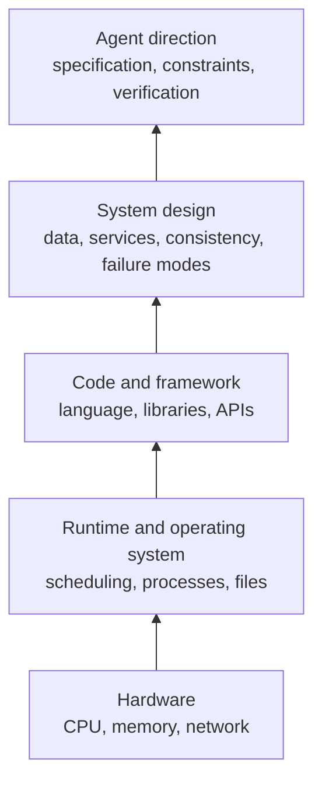
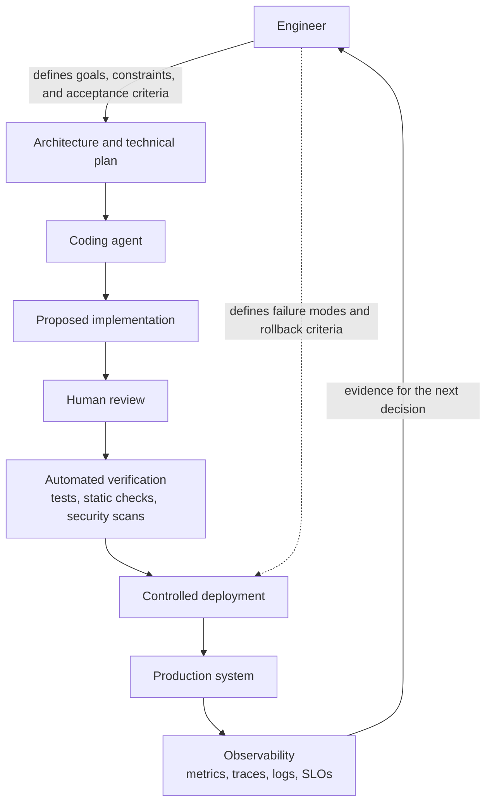

To become truly good at one layer of abstraction, you need to understand the layer beneath it.

That idea shaped much of computer science education. In college, we studied operating systems, software architecture, assembly language, microprocessors, compiler design, and other subjects that seemed far removed from the applications most of us would eventually build.

Few graduates would write assembly every day. Most would work in Python, JavaScript, Java, Go, or another high-level language. Yet the low-level education mattered.

It taught us what was happening underneath.

## Why Fundamentals Made Better Programmers

An engineer who understands memory allocation can reason about why an application slows down. Someone who understands operating systems can make better decisions about concurrency. Knowledge of compilers, processors, and networks makes performance problems feel less mysterious.

These fundamentals turn programming from an exercise in arranging syntax into an ability to predict system behavior.

That understanding has often separated great engineers from average ones. The difference was not that great engineers wrote more code. It was that they could see beyond the code they were writing.

They could ask better questions:

- Where will this fail under load?
- What happens when two requests arrive at once?
- What does this abstraction hide?
- What trade-off are we making in exchange for simplicity?
- How will we know this system is actually correct?

## The Layer Is Moving Up

Coding agents are changing where this principle applies.

As implementation increasingly becomes something we delegate to agents, the valuable abstraction layer is moving upward. Engineers will still need to understand code, but their primary work will increasingly involve shaping the systems that code belongs to.

The engineers who excel will be the ones who understand system design, distributed systems, architecture, design patterns, scalability, reliability, security, and the trade-offs behind technical decisions.

They will know what to build, why it should be built that way, and what could go wrong after the first demo succeeds.

An agent can generate an API, scaffold a service, write tests, refactor a module, or connect two systems remarkably quickly. But it cannot remove the need for judgment. Someone still has to decide whether the service should exist, where its boundaries belong, what data it owns, which failures are acceptable, and how the result will be verified.

Those are not merely coding questions. They are systems questions.

## What Engineers Need to Understand Next

The lower-level fundamentals are not disappearing. In fact, they remain essential. A system designer who does not understand databases, networks, queues, memory, and runtime behavior will still make poor decisions—just at a larger scale. The difference is that those fundamentals increasingly serve a higher-level purpose.

We once learned how computers worked so we could become better programmers.

The next generation of engineers will need to understand how complex software systems work so they can become better at directing the agents that build them.

That means learning to reason about:

- Architecture boundaries and ownership
- Failure modes and recovery paths
- Latency, throughput, and cost
- Data consistency and synchronization
- Security and trust boundaries
- Observability and verification
- The trade-offs hidden behind every “simple” implementation

Writing code was never the whole job. It was simply the layer where much of the work happened.

Now that layer is shifting. The best engineers will not be defined by how quickly they can type an implementation from scratch. They will be defined by how well they can turn an ambiguous problem into a sound design, guide an agent toward the right implementation, and recognize when the output is subtly wrong.